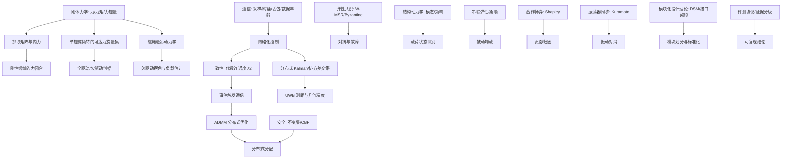

# 13 知识体系与多学科整合

> 前 12 章回答"这个领域有什么、缺什么"；本章回答"一个研究者应该怎样把这些知识组织成能用的结构"。综述是文献地图，知识体系是认知骨架：它决定你看到一个新问题时，第一反应去哪个概念节点、用哪套工具、拿什么证据判断。本章把 83 篇编号文献重新组织成五层知识栈、一张概念依赖图、一张多学科整合矩阵和 15 个关键知识节点；其中 [48]–[77] 为第二轮补充 30 篇，[78]–[83] 为第三轮复核新增 6 篇，与 [1]–[39] 第一轮核心语料一起构成 75 篇核心，[40]–[47] 为跨学科锚点。

## 13.1 五层知识栈

从"物理上能飞"到"学术上能证明"，知识是有依赖顺序的。跳过下层直接读上层论文，通常只能记住结论，无法判断结论成立的条件。

| 层 | 回答的问题 | 核心内容 | 本章锚点 |
| --- | --- | --- | --- |
| L1 问题域层 | 要解决什么、边界在哪 | 模块化、协同搬运、通信/定位/控制/容错/分配、评测 | [01]–[10] |
| L2 物理层 | 力从哪来、约束是什么 | 力旋量、抓取矩阵、倾转可达集、缆绳欠驱动、结构模态 | N1–N3, N11–N12 |
| L3 信息层 | 模块如何知道彼此状态 | 网络化控制、一致性、事件触发、分布式估计、UWB 几何 | N4–N5, N9–N10 |
| L4 决策层 | 每模块怎么算、怎么分 | ADMM、CBF 安全滤波、弹性共识、博弈分配、学习策略 | N6–N8, N13–N15 |
| L5 验证层 | 凭什么信 | 证据分级、评测协议、可复现性、失效注入 | [09], N11 |

**阅读顺序建议**：L1 建立坐标系 → L2 理解约束（决定哪些方案根本不可行）→ L3 理解信息约束（决定哪些方案在 ESP-NOW 上跑不动）→ L4 才是论文里的"方法"→ L5 判断证据。多数人从 L4 开始读，所以容易把"仿真里收敛"当成"能飞"。

## 13.2 概念依赖图

图中每个箭头是"理解 B 需要先理解 A"。这张图不是知识分类，而是**学习顺序**；按它读，比按章节读省时间。

## 13.3 多学科整合矩阵

"有机整合"不是把学科并列，而是明确每个学科**解决本领域的哪个子问题、贡献什么概念、证据强度如何**。下表是这张整合矩阵的实体化：

| 学科 | 贡献的核心概念 | 落在哪一章 | 代表文献 | 证据 |
| --- | --- | --- | --- | --- |
| 控制理论 | 一致性、网络化控制、事件触发、CBF | 06, 04 | [27][28][29][18][30][31][32][82][83] | A/B |
| 估计理论 | 分布式 Kalman、协方差交集、UWB 几何 | 05 | [23]–[26][58][59][60][63][79] | A/B |
| 通信/网络 | 时延-丢包-数据年龄、编码、网络设计 | 04 | [18]–[21][39] | A/B |
| 分布式系统 | CRDT、最终一致、拜占庭 | 04, 07 | [46][42][75] | A/B |
| 优化 | 分布式凸优化、ADMM、分配 | 08 | [33][40][58] | A/B |
| 博弈论 | 合作博弈、Shapley、机制设计 | 11, 12 | [2]（间接）、[64]（拍卖/机制设计） | B |
| 结构动力学 | 模态、频响、PSD、健康监测 | 12, 03 | [12]（间接）[71] | B |
| 安全与容错 | 弹性共识、故障隔离、安全滤波 | 07 | [34][35][42][69][75] | A/B |
| 设计科学 | 模块化、接口契约、real options | 02, 12 | [43][47][48][80][81] | A/B |
| 生物学（仿生） | 力感知协作、群体同步 | 03, 12 | [4][5][6][7][45] | A/B/C |
| 物流/标准化 | Physical Internet、容器化 | 02, 12 | [43] | A |

读法：先看"学科—章"两列，找到你当前章缺哪个学科的工具；再看"代表文献"是否已读。**没读过的学科，其概念不要写进方法章**——这是综述与"文献罗列"的分界线。

## 13.4 十五个关键知识节点

每个节点给：一句话定义、关键关系、为什么重要、锚点文献。节点是按依赖图排的，不是按章排的。

**N1 抓取矩阵与内力**：对刚性绑缚，模块力 f 合成为物体 wrench τ = G f；可行力分配 f = G⁺τ + N(G)λ，λ 是内力，**不改变物体运动、只改变模块间挤压**。刚性绑缚不会消除零空间，而是把零空间分量变成结构内力（预紧、疲劳的来源）；力分配因此要在最小范数解之外显式加内力抑制项——这是 G2 的理论根；刚性耦合的力平衡先例见 [78]。[9][17][78]

**N2 单旋翼倾转的可达力旋量集**：单旋翼的推力只沿桨轴；倾转两轴后可达集是一个二维流形嵌在六维 wrench 空间里。全驱动要求秩(G)=6，多模块组合才可能满足。倾转角限幅、舵机速率、桨盘面积共同决定可达集的形状——这决定"什么载荷能搬"的上界。[2][8][36]

**N3 缆绳悬吊的欠驱动**：缆绳只能拉不能推，负载摆角是欠驱动状态；好处是力分配由几何自动决定、可测拉力，坏处是摆角控制需要额外自由度。与我们"刚性绑缚 + 测力计"互补：刚性给力，柔性给被动均载；变惯量负载的观测器估计见 [79]。[10][14][15][50][53][79]

**N4 网络化控制**：采样、时延、丢包、数据年龄一起决定闭环稳定域；把通信当"理想管道"的设计在 ESP-NOW 上会失效。判断一个控制器的通信假设，先看它是否显式出现采样周期与丢包模型；事件触发通信的端到端学习方案见 [82][83]。[18][19][20][21][39][82][83]

**N5 一致性收敛速率与代数连通度**：多智能体平均一致收敛速率由通信图拉普拉斯矩阵第二小特征值 λ₂ 决定；λ₂ 小 → 收敛慢 → 队形误差大。丢包等效于降低 λ₂，所以"广播冗余"不是浪费。[27][28][29]

**N6 ADMM**：把约束最小二乘拆成"本地 x-更新 + 共享 z-更新 + 乘子 λ-更新"，每轮只交换 λ；通信轮数换精度。用于力矩分配时，3 轮与 20 轮的差距就是"通信预算 vs 分配质量"的 Pareto 前沿。[40][33]（[33] 为分布式优化综述；[58] 给出 ADMM 观测器的落地形态）

**N7 CBF 安全滤波**：给定安全集 h(x)≥0，控制不变性要求 ḣ + αh ≥ 0；作为 QP 约束叠加在名义控制器上，可保证不进入危险集（如模块间距下限、倾角上限）。是"安全"从口号变成约束的标准工具。[56]（CBF 分配）与 [69]（密度函数安全）

**N8 弹性共识 W-MSR**：每个节点丢弃偏离中位数最远的 f 个邻居值，再对剩余值取平均；在 f-local 攻击模型下收敛，前提是网络度 ≥ 2f+1。它是"模块可能说谎"时的最小代价防御。[42][75]

**N9 分布式 Kalman 与协方差交集**：分布式估计的难点不是滤波，是**相关性**——邻居的状态估计共享历史信息，直接融合会过度自信；协方差交集（CI）用保守融合避免这一点。UWB 距离是非线性观测，需 EKF/UKF 或因子图。[23][24][25][26][58][59][60]

**N10 UWB 几何精度**：测距误差经几何放大为位置误差，GDOP 由锚点构型决定；共线/共面锚点会退化。时间同步与测距是耦合的（TWR 需要往返时间），所以"定位 + 同步"应联合设计。[22][25][26][61][62]

**N11 模态与 PSD**：结构频响的峰值频率随刚度下降而下降、随质量增加而下降；松脱连接等效于局部刚度下降。用测力计/IMU 的 PSD 特征做载荷状态识别，前提是采样率覆盖关注频段（≥1 kHz 才能看到桨叶通过频率）。[71] 与 [12] 的工程注记

**N12 串联弹性**：连接刚度 K_s 与闭环带宽耦合：K_s 太低引入低频振荡，太高退化为刚性；被动均载降低力环带宽需求，但牺牲位置精度。存在"刚度—控制能量"的 U 形关系，是 C7 实验的核心假设。[12]

**N13 Shapley 值**：φ_i = Σ_{S⊆N\{i}} |S|!(n−|S|−1)!/n! · (v(S∪{i})−v(S))；在可加性贡献下等于边际贡献期望。n≤4 可精确枚举，适合"用实测力向量做公平归因"。[64] 的拍卖分配提供可操作的近似，方法论述评见 [2]（Shapley 原始文献不在本表编号内，仅作工具提及）

**N14 Kuramoto 序参量**：r·e^{iψ} = (1/N)Σ e^{iθ_j}；r→1 表示相位锁定，耦合强度超过临界值 K_c 时自发同步。反相锁定（耦合取负）可用于振动对消，但需要转子相位可测。[45]

**N15 模块化设计理论**：用设计结构矩阵（DSM）聚类识别模块边界，用接口契约（机械/电气/数据/时序/力额定）定义模块间承诺；模块化的收益来自"可替代性 + 并行开发"，代价是接口损耗与集成风险。把"模块化"从口号变成可度量设计决策。[43][47][48]，异质性与韧性分类见 [49]，任务自适应设计见 [80][81]

## 13.5 研究能力四级地图

知识体系不仅服务阅读，也服务"从读到做"的进阶。每一级给一个可检验的训练任务：

| 级别 | 能力 | 训练任务 | 判断标准 |
| --- | --- | --- | --- |
| R1 复现 | 把论文结果在自己的仿真/硬件上跑出来 | 复现 [10] 的单旋翼刚性协同搬运（简化） | 误差曲线与论文趋势一致 |
| R2 组合 | 把两个方法拼起来解决新组合 | 测力计 + 一致性 + ESP-NOW（A 主线雏形） | 组合后仍稳定，且通信量下降 |
| R3 迁移 | 把别的学科工具搬到本领域 | ADMM→力矩分配；CBF→安全约束；CRDT→慢变量 | 有可证明的性质 + 实验对照 |
| R4 提出 | 定义新问题、给出新判据 | "刚性绑缚 + 可测内力 + 单旋翼"的可行性判据 | 同行能复现、能引用 |

R1 到 R4 的分界不是"读了多少"，而是**能否说出方法的失效条件**。R4 的标志是：你能构造一个反例，说明现有方法在什么条件下不成立。

## 13.6 多轮检索记录（三轮滚动）

第一轮（39 篇）是"问题导向"检索：按 RQ1–RQ8 各配检索式。第二轮（30 篇）是"滚动 + 反查"：对第一轮的高被引/高相关论文做引文反查，并对 2025–2026 新工作做时间窗扫描。两轮之间隔了半小时，第二轮特意用了更窄的短语（如 `"sliding cable attachment"`、`"wrench-rate authority"`），命中率反而更高。

第二轮检索式（部分，完整 48 组见 [00](00_survey_method.md)）：

- `all:"modular aerial robot"` / `all:"modular multirotor"` / `all:"modular UAV"`
- `all:"cooperative aerial transport"` / `all:"sliding cable attachment"` / `all:"virtual-tube"`
- `all:"event-triggered" AND all:"formation control"` / `all:"string stability" AND all:"platoon"`
- `all:"UWB" AND all:"relative localization"` / `all:"GNSS-denied" AND all:"swarm"`
- `all:"control allocation" AND all:"multirotor"` / `all:"tilt-rotor"` / `all:"wrench-rate"`
- `all:"fault-tolerant" AND all:"multirotor"` / `all:"Byzantine" AND all:"robot"`
- `all:"structural health monitoring" AND all:"UAV"` / `all:"vibration" AND all:"multirotor"`
- `all:"series elastic" AND all:"aerial"` / `all:"active inference" AND all:"robot"`

**第二轮的三个发现**（说明为什么必须多滚几轮）：

1. **2026 年出现了一批"力分配 + 缆绳"的新工作**（[50][51][52][53]），第一轮只覆盖到 GPAC [14]；说明"缆绳工作正在从悬吊控制转向力分配"。
2. **倾转旋翼的可达性开始被形式化**（[54] "wrench-rate authority"、[56] CBF 分配、[55] gripper anchoring），第一轮只有"全驱动"概念，没有"速率受限"的现实约束。
3. **弹性共识/拜占庭从理论走向系统**（[75] blocklist、[76] 完全 Byzantine 鲁棒 MARL），与 [42] 的 W-MSR 形成"理论→协议→学习"三级。

筛选协议：去重 → 标题与摘要人工判相关 → 按"是否改变某个 gap 的判断"入选；不满足"能改变结论"的论文即使新也不收。30 篇全部经 arXiv id_list 逐条核对标题与首次提交日期，链接实测可达。

**第三轮：复核轮（防遗漏）**。第二轮之后又用 10 组"边界族"检索式做复核，专门查第一、二轮可能漏掉的交叉方向：`all:"ESP-NOW"`、`all:"force sensing" AND all:"aerial transport"`、`all:"modular docking"`、`all:"cooperative transport" AND all:"reinforcement learning"`、`all:"modular aerial" AND all:"reconfiguration"`、`all:"payload transport" AND all:"multi-UAV"`、`all:"event-triggered" AND all:"multi-agent" AND all:"consensus"`、`all:"tilt-rotor" AND all:"cooperative"`、`all:"air-ground" AND all:"transport"`、`all:"cooperative aerial transport" AND all:"force"`。共命中 67 条候选，与既有 63 条 arXiv 语料去重后剩 56 条，最终只纳入 6 条（[78]–[83]），其余多为空天网络、事件触发控制理论（无机器人验证）或地面交通，按排除标准剔除。

**第三轮的发现**：

1. **刚性耦合的力平衡有直接先例**（[78] 刚性耦合无人机协作平衡球），说明"刚性绑缚 + 力反馈"不是空白，但对象是球而非货物，缺负载内力分配。
2. **变惯量负载估计**（[79]）补上了"未知负载惯性"这一环，与我们"测力计可测绑缚力"互补：一个测力、一个估惯量。
3. **事件触发通信在协同搬运上有端到端学习方案**（[82][83]），可作为"ESP-NOW 低带宽下通信策略"的对照基线。
4. 模块化设计出现"任务自适应"路线（[80] 气动约束下的模块化空中机械臂、[81] 空地两用可重构平台），说明模块化正从"形态"走向"任务适配"——与 [11 创新点评分](11_innovation_scoring.md) 的 A 主线方向一致。

**三轮的分工**：第一轮建立问题坐标系（广度），第二轮补 2025–2026 新工作（时效），第三轮查边界族与遗漏（完备性）。三轮合计 75 篇核心（39 + 30 + 6），每一条都经 id_list 核对元数据。仍然无法覆盖的部分（ESP-NOW 学术文献、单旋翼倾转模块力分配、ESP32 上的 CRDT/Shapley 可行性）明确写进 13.7 的缺口，而不是用"多轮"掩盖。

## 13.7 知识缺口与更新机制

- **缺口**：ESP-NOW 没有对应学术文献（工程注记）；单旋翼倾转模块的力分配没有专门研究；刚性绑缚下的内力可测性只有 [9] 的抓取矩阵框架，没有实验验证；Shapley/CRDT/事件触发在真实 ESP32 硬件上的可行性都缺证据。
- **更新节奏**：每季度重跑第一轮检索式（48 组），每月对新增文献做一次标题扫描；新论文只有"改变某个 gap 判断"才入 core，否则进候选池。
- **证据升级**：B（预印本）一旦被正式录用，更新为 A 并记录；引用时以链接页为准。
- **防漂移**：每次更新在 [00](00_survey_method.md) 记录"检索日期、检索式、命中数、入选数"，避免"综述漂移"——读着读着，问题变了，文章却没变。

## 13.8 用这套体系做决策

给定一个研究方向，按 L1→L5 走一遍：

1. L1：它落在哪一章、对应哪条 gap？
2. L2：物理上可行吗（可达力旋量、内力、结构约束）？
3. L3：信息上可行吗（ESP-NOW 带宽/时延/丢包，UWB 几何）？
4. L4：方法上有什么工具（一致性/ADMM/CBF/弹性共识/学习）？
5. L5：证据够吗（有没有可复现的实验协议）？

任何一步答不上来，就回到对应知识节点补课。**这比"先想方法、再找实验"少走一半弯路**。

## 13.9 本章与 12 章的分工

- [12](12_cross_disciplinary.md) 是"横向发散"：12 个领域外透镜，找可能的创新点。
- 本章是"纵向收敛"：把发散得到的候选，接到五层知识栈、概念依赖图、多学科矩阵与 15 个知识节点上，判断它**卡在哪一层、缺哪块知识、需要什么证据**。

发散之后不收敛，候选池会变成负担；收敛之后不再发散，体系会僵化。两者交替，才是"有机整合"。
